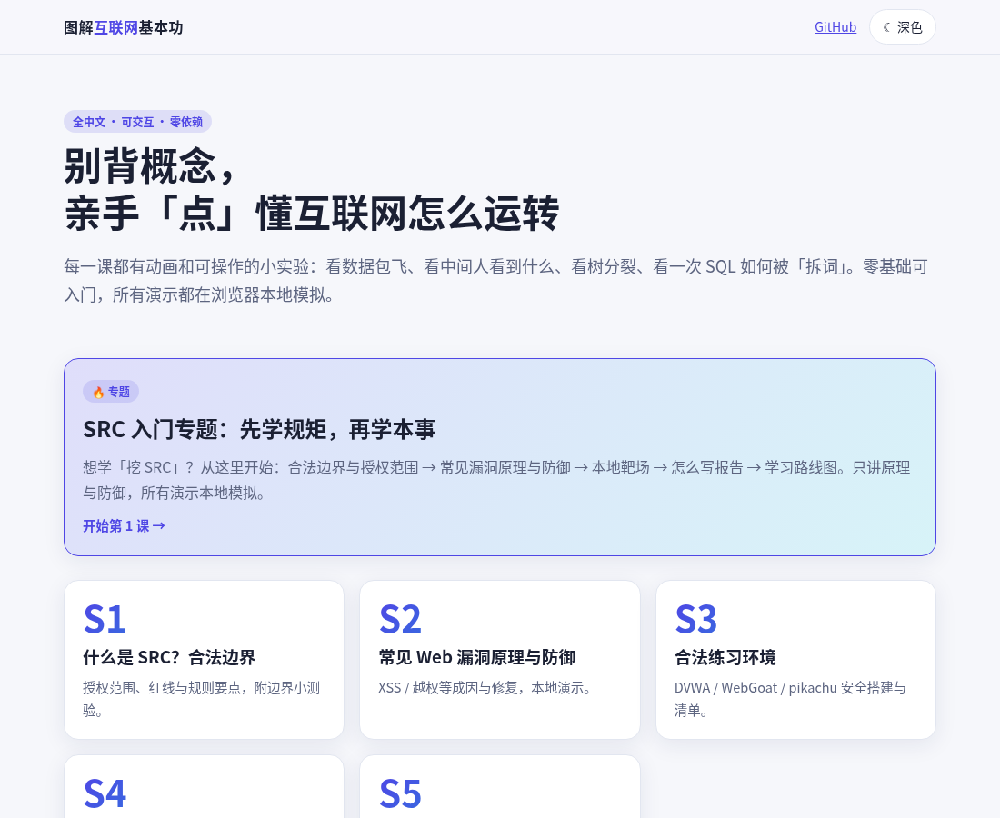
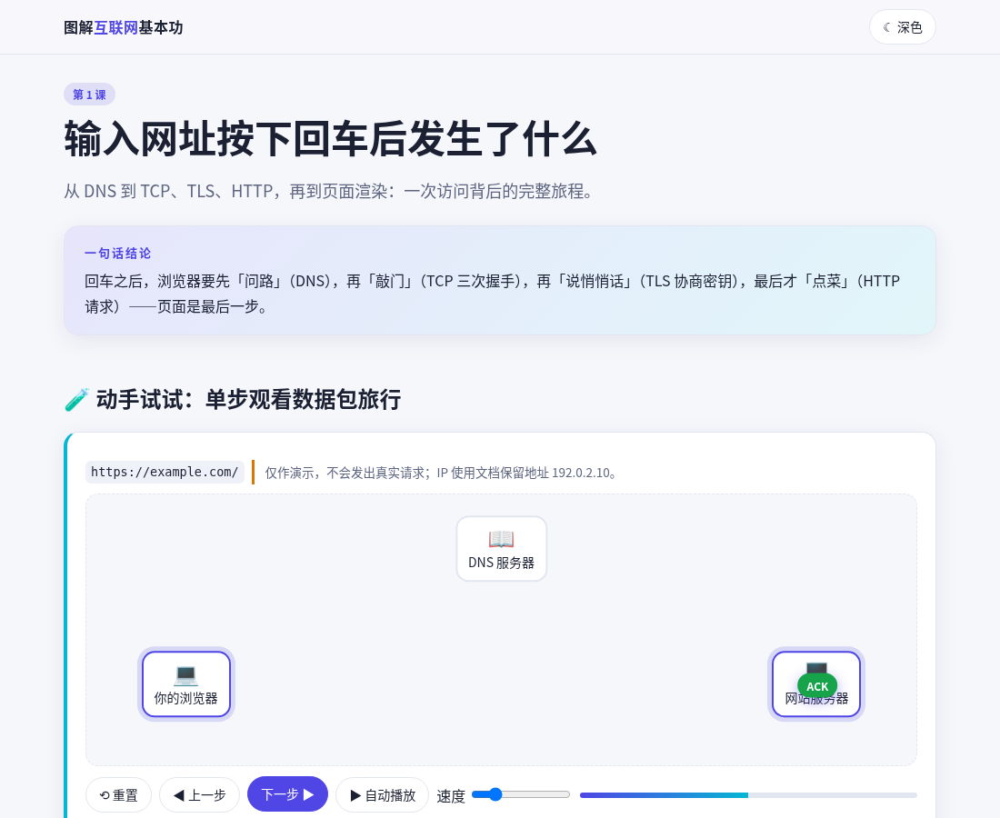
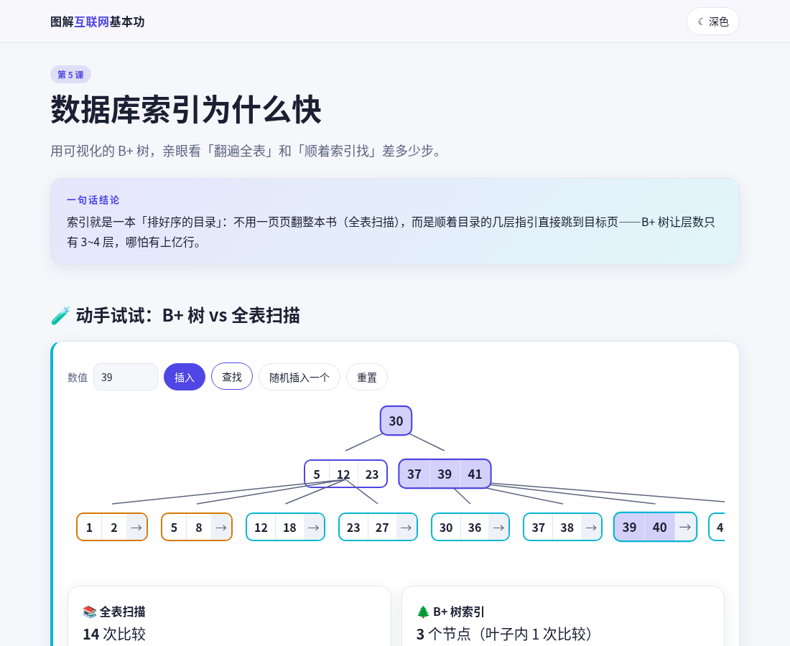
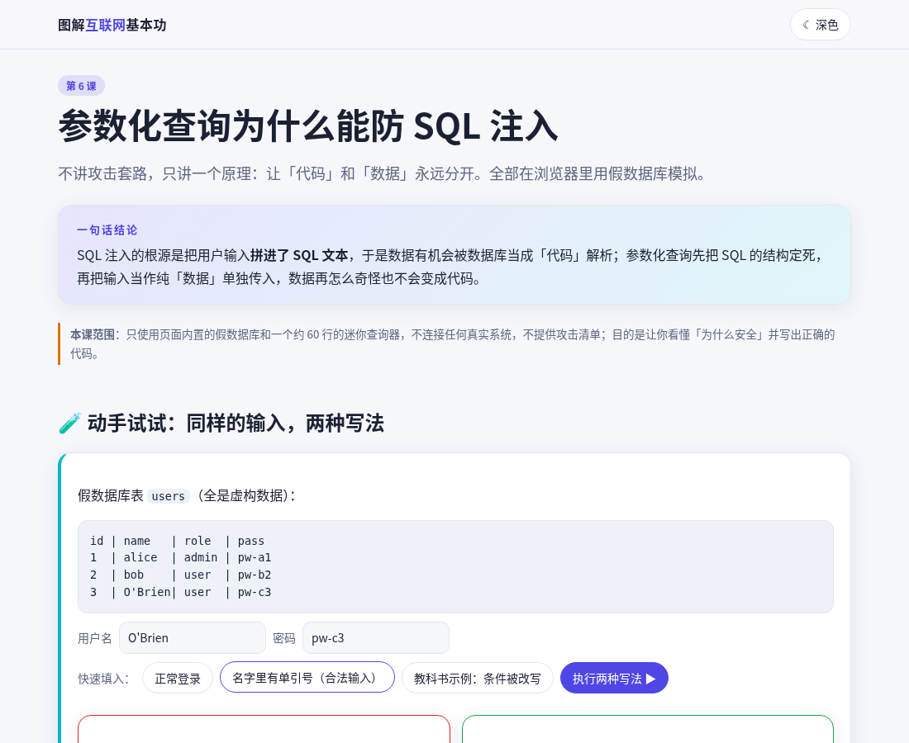
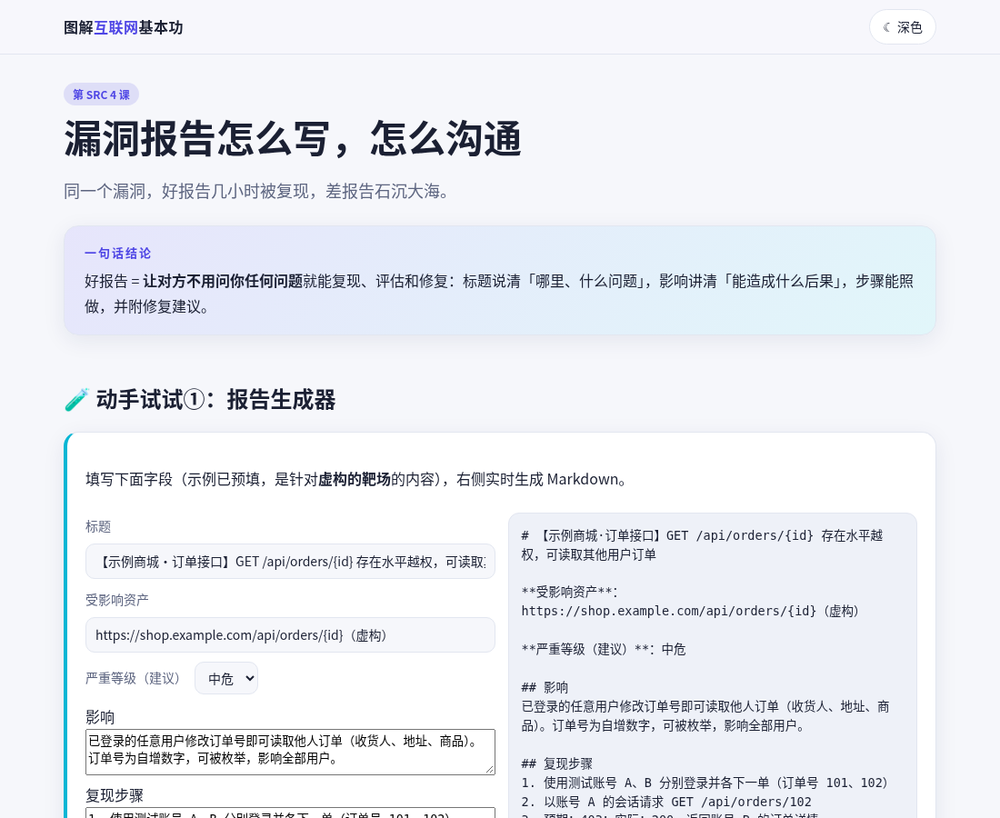

# 图解互联网基本功 · how-it-works-cn

> 全中文、可交互、逐步动画的「互联网与 Web 安全基本功」原理课。别背概念，亲手点懂它。

**🌐 在线体验：<https://ibi6.github.io/how-it-works-cn/>**

纯静态网页：**零依赖、无 CDN、无构建步骤**。所有演示都在浏览器本地用假数据模拟，不会发出任何真实网络请求。支持浅/深色，响应式，并尊重系统的「减少动态效果」设置。



## 目录

### 🔥 SRC 入门专题（先学规矩，再学本事）
| 课 | 内容 | 动手试试 |
|---|---|---|
| [S1 什么是 SRC？合法边界](docs/lessons/src-1-scope.html) | 授权范围、红线、平台规则要点 | 8 道「这样做合法吗」边界小测验 |
| [S2 常见 Web 漏洞原理与防御](docs/lessons/src-2-vulns.html) | 成因 → 影响 → 修复 | XSS 转义对比、越权(IDOR)开关 |
| [S3 合法练习环境](docs/lessons/src-3-lab.html) | DVWA / WebGoat / pikachu 本地安全搭建 | 命令生成器 + 安全清单 |
| [S4 漏洞报告与沟通](docs/lessons/src-4-report.html) | 标题、影响、步骤、修复、定级、礼仪 | 报告生成器 + 定级直觉 |
| [S5 学习路线图](docs/lessons/src-5-roadmap.html) | 基本功 → 靶场 → 公开报告 → 合规参与 | 可勾选进度（存在本地浏览器） |

### 基础原理课
| 课 | 一句话 |
|---|---|
| [1 输入网址按下回车后发生了什么](docs/lessons/01-url.html) | DNS → TCP 三次握手 → TLS 1.3 → HTTP → 渲染，数据包动画可单步、可调速 |
| [2 HTTPS 为什么安全](docs/lessons/02-https.html) | 切换明文/加密看中间人视角；锁与钥匙类比；证书链验证 |
| [3 Cookie / Session / JWT](docs/lessons/03-session.html) | 三种方案对比；HttpOnly/Secure/SameSite 模拟；现场签发与验签 JWT |
| [4 同源策略与 CORS](docs/lessons/04-cors.html) | 模拟「为什么被拦」，弄懂简单请求与预检 |
| [5 数据库索引为什么快](docs/lessons/05-index.html) | B+ 树可视化：插入、分裂、查找步数 vs 全表扫描 |
| [6 参数化查询为什么能防 SQL 注入](docs/lessons/06-sqli.html) | 假数据库 + 迷你查询器，看懂「代码与数据分离」 |

| | |
|---|---|
|  |  |
|  |  |

## 本地运行
```bash
cd docs && python3 -m http.server 8000   # 或任意静态服务器，打开 http://localhost:8000
```
（第 3 课的 JWT 演示用到 WebCrypto，需要 `localhost` 或 HTTPS。）

## 怎么贡献新课
1. 复制 `docs/lessons/01-url.html` 作为模板，保留 `<head>` 中的样式/脚本引用和页首、页尾结构。
2. 每课必须包含：**一句话结论**（`.tldr`）、**动手试试**（`.card.lab`，可交互）、**常见误区**（`.myth`）、**延伸阅读**。
3. 分步动画直接用 `HIW.stepper(容器, 步骤数组, 回调)`（见 `docs/assets/common.js`）。
4. 协议细节要严谨；做了省略的地方用 `.note` 标注「简化示意」。
5. 延伸阅读只链接真实可访问的页面（MDN、RFC、OWASP 等），提交前用 `curl -I` 检查。
6. 在 `docs/index.html` 的 `B` 或 `S` 数组里登记新课，并更新本 README 目录。
7. **内容红线**：只做原理与防御。不接受针对第三方系统的攻击步骤、可直接利用的载荷清单，或扫描、爆破、远程利用类代码。演示必须在浏览器本地模拟。

## 诚实的局限
- 所有演示是**简化模型**，不是真实协议栈：例如 TLS 部分是 1.3 的概念流程，加密用异或示意，不是真的 AES；CORS 模拟省略了缓存、Vary、Expose-Headers 等；B+ 树阶数很小，只为便于观察。
- SQL 迷你查询器只支持极小的语法子集，只服务于教学，**不能代表任何真实数据库的解析细节**。
- SRC 专题是通用科普，**不是法律意见**；各平台规则和各地法律会变化，请以最新官方规则和法条为准。
- 主要在 Chromium（无头）下验证过；Safari / Firefox 与触屏设备只做了基础检查。
- 无障碍支持有限（有基本的 aria-live 与键盘可达，但没有系统审计）。
- 暂无自动化测试框架，验证靠脚本逐页打开检查（见 `tools/check.mjs`）。

## 许可
[MIT](LICENSE)
